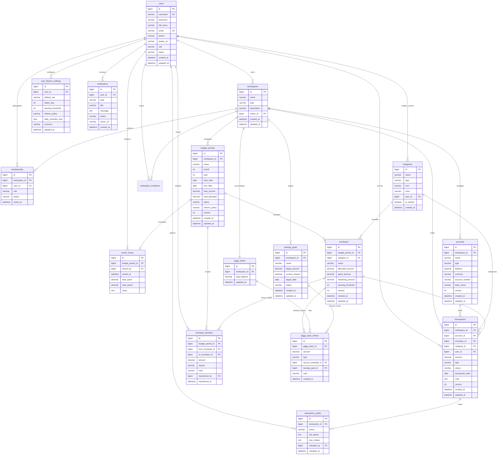

# SƠ ĐỒ QUAN HỆ THỰC THỂ (ERD) - DỰ ÁN SMARTENVELOPE

Hệ thống cơ sở dữ liệu **SmartEnvelope** được thiết kế chuẩn hóa theo mô hình quan hệ (RDBMS) trên MySQL 8+, phục vụ triết lý quản lý tài chính **Zero-based Budgeting (ZBB)** và phương pháp chia tiền vào phong bì (**Envelope Budgeting**).

Hệ thống gồm 16 bảng thực thể được phân thành 4 phân hệ chính:
1. **Core & Access Control**: `users`, `workspaces`, `memberships`, `categories`.
2. **Accounts & Budgeting (Kỳ ngân sách & Phong bì)**: `accounts`, `budget_periods`, `envelopes`.
3. **Transactions & Audit Ledger (Giao dịch & Kiểm toán)**: `transactions`, `envelope_transfers`, `transaction_audits`.
4. **Savings & Notifications (Tích lũy & Cảnh báo)**: `user_finance_settings`, `savings_goals`, `piggy_banks`, `piggy_bank_entries`, `month_closes`, `notifications`.

---

## 1. Sơ đồ tổng thể toàn hệ thống (Mermaid ERD)

---

## 2. Chi tiết luồng liên kết giữa các bảng

1. **Workspace Ownership & Phân quyền thành viên**:
   - `users (1) -> (N) workspaces`: Mỗi người dùng có thể tạo một hoặc nhiều workspace (ví dụ: "Quỹ cá nhân", "Quỹ gia đình").
   - `workspaces (1) -> (N) memberships <- (N) users`: Quan hệ nhiều-nhiều cho phép mời thành viên khác vào chung workspace với vai trò `OWNER`, `MANAGER`, `WRITER`, `VIEWER`.
2. **Kỳ ngân sách và Phong bì (Zero-based Budgeting)**:
   - `workspaces (1) -> (N) budget_periods`: Mỗi tháng một workspace lập 1 kỳ ngân sách.
   - `budget_periods (1) -> (N) envelopes`: Trong một kỳ, thu nhập được phân bổ 100% vào các phong bì (`allocated_amount`).
   - `categories (1) -> (N) envelopes`: Mỗi phong bì đại diện cho một danh mục chi tiêu cụ thể.
3. **Ghi nhận chi tiêu và Sổ cái kép**:
   - `accounts (1) -> (N) transactions`: Chi tiêu làm giảm số dư tài khoản thực tế (`accounts.balance`).
   - `envelopes (1) -> (N) transactions`: Chi tiêu làm tăng số đã chi (`envelopes.spent_amount`) và giảm số dư phong bì (`envelopes.remaining_amount`).
   - `transactions (1) -> (N) transaction_audits`: Mọi hành động SỬA/XÓA/HỦY giao dịch đều ghi nhật ký kiểm toán bất biến.
4. **Bù đắp ngân sách và Kết thúc kỳ (Rollover)**:
   - `envelopes (from/to) -> (N) envelope_transfers`: Chuyển tiền giữa các phong bì khi phát sinh chi vượt hạn mức.
   - `budget_periods (1) -> (1) month_closes`: Chốt sổ cuối tháng, tính toán tổng tiết kiệm.
   - `envelopes -> (N) piggy_bank_entries -> (1) piggy_banks`: Quét tiền dư các phong bì vào Heo đất tích lũy theo chính sách `SWEEP_TO_PIGGY`.

